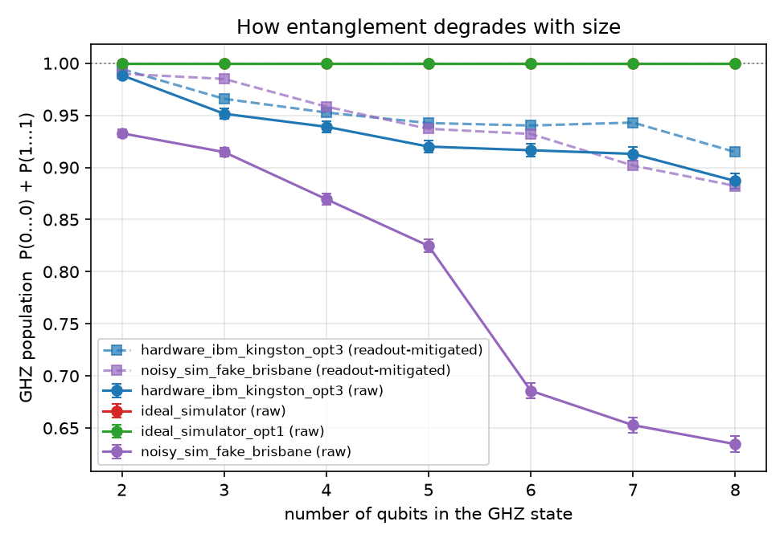

# How Entanglement Degrades on Real Quantum Hardware (Qiskit, IBM Quantum)

Prepare GHZ states, (|00…0⟩ + |11…1⟩)/√2, on 2 to 8 qubits and measure how much of the ideal state survives on a perfect simulator, on a simulator with the noise of a real IBM chip, and on real IBM quantum hardware, before and after readout-error mitigation.

## Key results

| Finding | Evidence |
| --- | --- |
| **Real hardware keeps most of the entanglement up to 8 qubits** | On IBM `ibm_kingston` (156 qubits): GHZ population 0.988 at 2 qubits, 0.887 at 8 (0.994 and 0.915 after readout mitigation) |
| **Qubit choice matters as much as qubit count** | On a simulated 127-qubit IBM device, one qubit misread 18.9% of the time; noise-aware qubit selection raised the 8-qubit score from 0.624 to 0.871, the same quality as 4 qubits on the default choice (0.873) |
| **Measurement errors can dominate small circuits** | Simulated 2-qubit GHZ: 0.939 raw vs 0.990 after readout mitigation, so about 85% of the loss was readout |

## The experiment

1. **Circuit.** Hadamard on qubit 0, then a chain of CNOTs 0→1→2→… Ideally, every measurement gives all zeros or all ones, 50/50.
2. **Score.** GHZ population = P(0…0) + P(1…1): 1.0 for a perfect device, lower when noise flips qubits. It upper-bounds the true GHZ fidelity, because it checks populations but not the phase between the two branches.
3. **Compile for the device.** Qiskit's transpiler maps the circuit onto the chip's native gates and qubit connections; the script records the resulting two-qubit gate count and depth.
4. **Readout-error mitigation.** Two calibration circuits (all qubits in |0⟩, all in |1⟩) on the *same physical qubits* give each qubit's misread probabilities. Inverting the resulting confusion matrix removes measurement errors from the GHZ result, leaving the errors from the gates and decoherence.

## Setup

```bash
python -m venv .venv
.venv\Scripts\activate            # macOS/Linux: source .venv/bin/activate
pip install -r requirements.txt
pip install -e .
pytest -v                          # 10 tests
```

## Step 1: Simulators

```bash
python scripts/run_study.py --backend ideal    # sanity check: everything 1.000
python scripts/run_study.py --backend fake     # noise model of IBM Brisbane, offline
python scripts/plot_results.py                 # results/ghz_population.png
```

## Step 2: Real IBM hardware

```bash
python scripts/save_ibm_account.py                          # once: API key + instance CRN, stored outside the project
python scripts/run_study.py --backend ibm --opt-level 3 --shots 2000
```

All 21 circuits (7 GHZ sizes × GHZ + 2 calibration circuits) run in one job.

## Results

GHZ population P(0…0) + P(1…1); ± is the shot-noise standard error of the raw value.

| Qubits | Simulated IBM Brisbane, default qubits (raw / mitigated) | Simulated IBM Brisbane, noise-aware qubits (raw / mitigated) | **IBM `ibm_kingston` hardware, noise-aware qubits (raw / mitigated)** |
| --- | --- | --- | --- |
| 2 | 0.939 / 0.990 | 0.980 / 0.997 | **0.988 ± 0.002 / 0.994** |
| 3 | 0.919 / 0.983 | 0.963 / 0.991 | **0.952 ± 0.005 / 0.966** |
| 4 | 0.873 / 0.962 | 0.948 / 0.984 | **0.939 ± 0.005 / 0.953** |
| 5 | 0.826 / 0.924 | 0.925 / 0.971 | **0.920 ± 0.006 / 0.943** |
| 6 | 0.680 / 0.929 | 0.913 / 0.977 | **0.916 ± 0.006 / 0.940** |
| 7 | 0.649 / 0.891 | 0.888 / 0.963 | **0.913 ± 0.006 / 0.943** |
| 8 | 0.624 / 0.882 | 0.871 / 0.949 | **0.887 ± 0.007 / 0.915** |

The ideal simulator gives 1.000 at every size, confirming the circuits are correct.



### What the results show

- **A single bad qubit.** With the default layout (physical qubits 0, 1, 2, …), the raw score drops sharply at 6 qubits (0.826 → 0.680) while the mitigated score barely moves (0.924 → 0.929). The cause is physical qubit 5, with an 18.9% readout error against 1–3% for its neighbours (`scripts/show_readout.py`).
- **Noise-aware layout.** Transpiling at optimisation level 3 scores candidate qubit sets by their reported error rates and avoids that qubit; readout errors of the chosen qubits fall to 0.6–1.6%. The mitigated scores also improve (0.882 → 0.949 at 8 qubits), so the chosen qubits have better gates and coherence too, not only better readout.
- **Hardware.** On `ibm_kingston` the score decays from 0.988 to 0.887 over 2 → 8 qubits. Readout mitigation adds little at small sizes (0.988 → 0.994), so on this device most of the loss comes from the CNOT chain and decoherence.
- **No SWAPs were needed:** a CNOT chain maps onto a line of connected qubits, so every size used exactly n − 1 two-qubit gates.

### Caveats

- **Population, not fidelity.** P(0…0) + P(1…1) ignores the phase between the two branches; it is an upper bound on GHZ fidelity. Measuring parity in rotated bases would give the full fidelity.
- **Different qubits for each size.** The noise-aware layout picks the best qubit set for each n separately, so the hardware curve mixes qubit sets; small non-monotonic steps (6 → 7 qubits) are within the error bars.
- **Single run** per configuration on a device whose calibration drifts over time.

## Repository layout

```
├── src/ghznoise/
│   ├── experiment.py     # GHZ + calibration circuits, compiling, running, scoring
│   └── mitigation.py     # readout confusion matrices and their inversion (NumPy only)
├── scripts/
│   ├── run_study.py         # one backend -> results/ghz_<backend>_opt<level>.json
│   ├── plot_results.py      # all backends -> results/ghz_population.png
│   ├── show_readout.py      # readout error per physical qubit
│   └── save_ibm_account.py  # one-time IBM Quantum credentials
└── tests/
```

## Tech stack

Python, Qiskit, Qiskit Aer, Qiskit IBM Runtime, NumPy, Matplotlib, pytest
